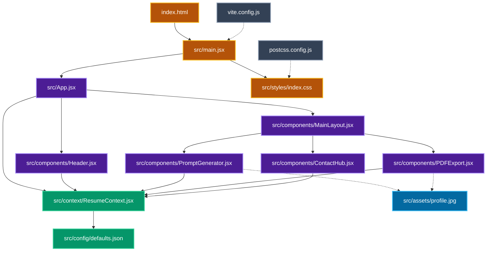

# AI Resume Architect Architecture

This document maps out the dependency graph and file structure for the AI Resume Architect application.

## Dependency Graph

The following Mermaid graph illustrates how the React components and files depend on each other. When an AI or developer needs to modify a specific part of the app, they can trace these connections to understand what else might be affected to save tokens and context limit.



## File Structure

```text
ai-resume-architect/
├── src/
│   ├── assets/
│   │   └── profile.jpg
│   ├── components/
│   │   ├── ContactHub.jsx
│   │   ├── Header.jsx
│   │   ├── MainLayout.jsx
│   │   ├── PDFExport.jsx
│   │   └── PromptGenerator.jsx
│   ├── config/
│   │   └── defaults.json
│   ├── context/
│   │   └── ResumeContext.jsx
│   ├── styles/
│   │   └── index.css
│   ├── App.jsx
│   └── main.jsx
├── ARCHITECTURE.md
├── index.html
├── package.json
├── package-lock.json
├── postcss.config.js
├── README.md
└── vite.config.js
```

## File Descriptions

### Application Entry & Assets
* **`index.html`**: The root HTML file that mounts the React application.
* **`src/main.jsx`**: The React entry point. Renders the root `<App />` and imports the global stylesheet.
* **`src/styles/index.css`**: The main Tailwind v4 CSS file containing base styles, theme variables, custom glassmorphism card queries, and background animations.
* **`src/assets/profile.jpg`**: The default professional headshot bundled with the application for instant photo-enabled resume rendering.

### Core Components
* **`src/App.jsx`**: Wraps the application in the `ResumeContext` and defines the core layout (header + main content) along with the animated background orbs.
* **`src/components/Header.jsx`**: The top navigation bar. Contains the branding logomark, the Mode Switcher (Visual vs ATS), and the light/dark Theme Toggle.
* **`src/components/MainLayout.jsx`**: The two-column grid layout container holding the application's main functional sections.

### Feature Components
* **`src/components/PromptGenerator.jsx`**: The left-hand panel where the user inputs the job description. It dynamically generates robust, mode-aware AI prompts for the resume and optional cover letter/lead extraction, with 1-click copy and expand-to-modal features. Includes:
  * **Photo Customization Suite** — controls the profile headshot:
    * Toggle switch with theme-adaptive styling.
    * Photo preview thumbnail with status tag.
    * Native file picker upload button (`accept="image/*"`).
    * One-click "Reset" button reverting to default `profile.jpg`.
    * Size controls: **S** (36pt), **M** (42pt exact fit), **L** (50pt), **XL** (58pt).
    * Shape options: **Rounded** (3px), **Squircle** (6px), **Circle**, and **Square**.
    * Border styles: **Border** (subtle frame), **Borderless** (clean), and **Accent** (mode-colored).
  * **Six Toggleable Prompt Modifiers**:
    * **JD Keyword Audit** — injects a chain-of-thought keyword audit into the prompt. The AI extracts every meaningful keyword/skill/tool from the JD, outputs a structured `## KEYWORD AUDIT` block (Must-Match / Skill Gaps Applied / Skipped) as a committed scratchpad, then writes the document using that list. Applies to resume and cover letter prompts. Off by default.
    * **Need Cover Letter?** — appends a dedicated cover letter prompt section.
    * **Target HR Lead?** — generates a Lead Intel prompt to extract recruiter name, email, company, and location from the job description for the ContactHub.
    * **Score & Fix to ~100** — injects a single ATS scoring instruction into the resume prompt. The AI acts as an ATS, scores the generated resume out of 100, and lists exact gaps to fix to reach 95+.
    * **Reframe Older Experience** — instructs the AI to rewrite older job role titles (not the most recent) into user-specified target roles.
    * **Weave In Unfamiliar Tools** — instructs the AI to naturally mention user-specified tools in older experience bullets where contextually plausible.
* **`src/components/PDFExport.jsx`**: The right-hand panel where the user pastes the AI-generated markdown. It renders live previews of both documents using distinct, optimized typography for each. Features include:
  * **Profile Photo Overlay Engine** — renders the active headshot (`customPhoto || profilePhoto`) anchored via `top: calc(var(--resume-pad) + 40.5pt - var(--photo-size)); right: var(--resume-pad); transform-origin: bottom right;`. Keeps the photo base aligned with the title horizontal baseline while expanding upwards and to the left.
  * **Full Modal Preview** — click-to-expand preview with identical photo positioning and typography.
  * **Print Isolation Logic** — independent CSS print engine for exporting the Resume, Cover Letter, or a combined PDF natively via the browser (`@media print`), ensuring full parity between screen and PDF output.
  * **Strict PDF Title Metadata** — requires a manual filename input and synchronously overrides the DOM `document.title` via `flushSync` before triggering the print dialog.
  * **Lead Outreach Editor** — processes AI-extracted HR contacts into the global state.
* **`src/components/ContactHub.jsx`**: A persistent dashboard at the bottom of the layout that displays and manages saved HR leads. It features search, manual editing, "Reach Out" links, and CSV export functionality for recruitment tracking.

### Context & State
* **`src/context/ResumeContext.jsx`**: The global state manager (using React Context). It handles persisting data to `localStorage` (theme, mode, AI results, resume texts, contacts, and photo preferences: `includePhoto`, `photoSize`, `photoShape`, `photoBorder`, `customPhoto`) so user progress isn't lost on refresh. Provides `resetPhoto()` to restore the default image.
* **`src/config/defaults.json`**: Contains the default baseline resume data injected into the application on first load.

### Configuration
* **`vite.config.js`**: Build settings for the Vite development server and bundler.
* **`postcss.config.js`**: Wiring for `@tailwindcss/postcss`.
